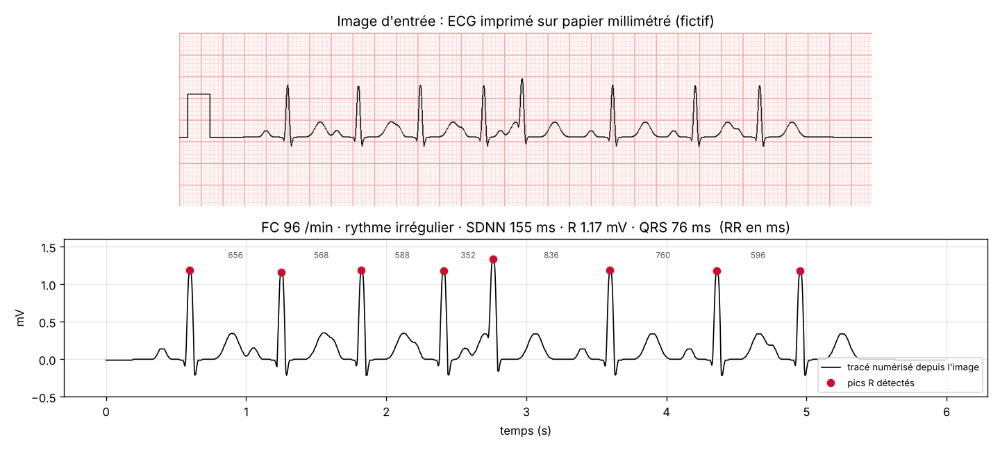

# Vision-ECG : extraire les paramètres physiologiques d'une image d'électrocardiogramme

🇫🇷 [Français](#français) · 🇬🇧 [English](#english)



> ECG **de synthèse** imprimé sur un papier millimétré généré par le programme : aucune donnée de patient. Projet d'étude, **pas un dispositif médical**.

---

## Français

### Le problème
Beaucoup d'ECG existent seulement sur papier ou en photo : dans un dossier scanné, un compte rendu, une ancienne archive. Pour les exploiter, il faut retrouver le **signal** à partir de l'**image**, puis en tirer les mesures habituelles.

### Ce que fait le code
1. **Séparer le tracé de la grille** grâce à la couleur : tracé sombre, grille rosée.
2. **Mesurer l'échelle** : le pas de la grille est trouvé par autocorrélation du profil des lignes, puis affiné sur les gros carreaux de 5 mm. On obtient les pixels par millimètre, donc le temps (25 mm/s) et la tension (10 mm/mV).
3. **Contrôler l'étalonnage** sur l'impulsion de 1 mV du début de bande.
4. **Numériser** : une valeur par colonne de pixels. Sur les ondes raides (pic R), le trait est presque vertical, alors on garde le pixel le plus éloigné de la ligne de base pour ne pas sous-estimer les pics.
5. **Mesurer** :
   - pics R par l'énergie de la dérivée, avec seuil et période réfractaire ;
   - fréquence cardiaque, intervalles RR et variabilité (SDNN) ;
   - amplitude de l'onde R par rapport à la ligne isoélectrique (segment PR) ;
   - durée du QRS.
6. **Interpréter** : bradycardie ou tachycardie, rythme régulier ou irrégulier, QRS fin ou élargi (≥ 120 ms).

### Utilisation
```bash
python extraire.py                       # génère et analyse 4 exemples
python extraire.py exemples/irregulier.png
```
```
== exemples/irregulier.png
   grille : 8.00 px/mm · étalonnage mesuré : 10.0 mm/mV
   15 battements · FC 96 /min (normale) · rythme irrégulier
   RR moyen 627 ms · SDNN 117 ms
   onde R 1.17 mV · QRS 76 ms (fin)
```

### Fichiers
| Fichier | Contenu |
|---|---|
| `visionecg/papier.py` | génération d'ECG de synthèse sur papier millimétré (image PNG) |
| `visionecg/extraction.py` | séparation, échelle, étalonnage, numérisation, pics R, mesures |
| `extraire.py` | rapport en ligne de commande |
| `exemples/` | 4 images fictives : normal, tachycardie, rythme irrégulier, QRS élargi |
| `figures.py` | figure ci-dessus (matplotlib) |
| `tests/test_visionecg.py` | 61 vérifications : `python tests/test_visionecg.py` |

Comme les images sont générées, on connaît la vérité. Les tests vérifient que le pas de la grille est retrouvé à 1 % près pour 4 résolutions, l'étalonnage à 10 mm/mV, l'erreur de numérisation hors QRS (moins de 0,02 mV), le nombre exact de battements et la position des pics R (moins de 12 ms d'écart) de 45 à 140 /min, l'amplitude R, la variabilité, et la reconnaissance du rythme irrégulier et du QRS élargi.

### Limites
- Images propres et droites. Une vraie photo demanderait de redresser la perspective, de corriger l'éclairage et de séparer plusieurs dérivations.
- Une seule dérivation par image, vitesse et gain supposés standards (25 mm/s, 10 mm/mV).
- La durée du QRS dépend du seuil de pente choisi : c'est une estimation.

Dépendances : `numpy`, `Pillow` (et `matplotlib` pour la figure). Projet écrit en 2026.

---

## English

**Extracting physiological parameters from an ECG image.** The tool separates the trace from the grid by colour, measures the grid pitch by autocorrelation (pixels per mm), checks the 1 mV calibration pulse, digitises the trace column by column (keeping the extreme pixel on steep waves), then detects R peaks and computes heart rate, RR intervals, SDNN, R amplitude above the isoelectric line and QRS duration, with a simple interpretation (brady/tachycardia, irregular rhythm, wide QRS).

```bash
python extraire.py
python tests/test_visionecg.py   # 61 checks
```

**Synthetic** ECGs on generated graph paper, no patient data. Not a medical device. Requires `numpy`, `Pillow` (`matplotlib` for the figure). Written in 2026.
